# DER — SISZOO

### Diagrama Entidade-Relacionamento · Sistema de Gestão do CCZ-Itu

> Documento de referência derivado das **15 telas + Design System** do protótipo navegável. Use-o para comparar com seu schema atual e validar cobertura.

> **Estado do schema (V18).** As tabelas de usuários/acesso, animais, baias, registros clínicos (`vacinacao`, `procedimento`, `prescricao`), ocorrências (§3.4), processo sanitário (§3.5, exceto `documento_processo`) e seus catálogos estão descritas aqui **como existem nas migrations** (`backend/src/main/resources/db/migration`, V1–V18; a V11 só corrige a matriz de permissões, §3.1, a V12 só acrescenta a ação de auditoria `VISUALIZACAO`, §3.8, a V13 completa o processo sanitário, T29, a V14 cria o histórico de resultados, T34, a V15 completa as garantias desse histórico e reconcilia o legado da D18, a V16 normaliza o microchip, §3.2, a V17 recusa a exclusão de registros críticos, §3.2 e §3.5, e a V18 recalcula `ficha_completa` dos animais existentes, §3.2). As demais (relatórios, `adocao`, `exame`, anexos de animal, `documento_processo`) ainda **não têm tabela**: são o modelo-alvo, a validar na implementação de cada módulo.

**Convenções**

- `PK` chave primária · `FK` chave estrangeira · `?` opcional (nullable) · `*` obrigatório
- `enum` valor de tabela-domínio (catálogo)
- Datas em UTC, exibição em America/São_Paulo (DD/MM/AAAA — fixo)
- Idioma: PT-BR somente
- Bairro: campo livre (sem catálogo fechado)

---

## 1. Visão geral — telas × módulos

| Tela                                                                 | Módulo                 | Entidades-chave                                                                                                  |
| -------------------------------------------------------------------- | ---------------------- | ---------------------------------------------------------------------------------------------------------------- |
| `login.html`                                                         | Autenticação           | `usuario` (JWT stateless — sessão não é persistida)                                                              |
| `dashboard.html`                                                     | Agregações             | views/derivadas de quase tudo                                                                                    |
| `alerta.html`                                                        | Alertas (detalhe)      | `alerta_*` (computado)                                                                                           |
| `animais.html` / `animal.html` / `cadastrar-animal.html`             | Animais                | `animal`, `vacinacao`, `procedimento`, `prescricao`, `exame`, `adocao`                                           |
| `ocorrencias.html` / `ocorrencia.html` / `cadastrar-ocorrencia.html` | Ocorrências            | `ocorrencia`, `denunciante`, `denunciado`, `movimentacao_ocorrencia`, `anexo_ocorrencia`                         |
| `processos.html` / `processo.html` / `cadastrar-processo.html`       | Processos Sanitários   | `processo_sanitario`, `responsavel_processo`, `animal_amostrado`, `documento_processo`, `resultado_laboratorial` |
| `baias.html`                                                         | Infraestrutura         | `baia`                                                                                                           |
| `usuarios.html`                                                      | Administração          | `usuario`, `cargo`, `usuario_cargo`                                                                              |
| `relatorios.html` + `relatorios/*`                                   | Relatórios             | `relatorio_gerado`, `tipo_relatorio`                                                                             |
| `configuracoes.html`                                                 | Preferências/catálogos | `preferencia_usuario`, `catalogo_*`, `auditoria_evento`                                                          |

---

## 2. Diagrama (Mermaid ER)

> Cole em qualquer renderer Mermaid (Mermaid Live, VSCode, GitHub) ou no [mermaid.ink](https://mermaid.ink) para gerar PNG.

```mermaid
erDiagram

  %% ============ USUÁRIOS / SEGURANÇA ============
  USUARIO ||--o{ USUARIO_CARGO : "recebe"
  CARGO ||--o{ USUARIO_CARGO : "concedido via"
  USUARIO ||--|| PREFERENCIA_USUARIO : "configura"
  USUARIO ||--o{ AUDITORIA_EVENTO : "produz"
  CARGO ||--o{ CARGO_PERMISSAO : "concede"

  %% ============ ANIMAIS ============
  ANIMAL }o--|| ESPECIE : "é"
  ANIMAL }o--|| STATUS_ANIMAL : "está"
  ANIMAL }o--|| MOTIVO_ENTRADA : "entrou por"
  ANIMAL }o--o| BAIA : "ocupa"
  ANIMAL ||--o{ VACINACAO : "recebeu"
  ANIMAL ||--o{ PROCEDIMENTO : "passou"
  ANIMAL ||--o{ PRESCRICAO : "toma"
  ANIMAL ||--o{ EXAME : "tem"
  ANIMAL ||--o| ADOCAO : "foi adotado em"
  ANIMAL ||--o{ ANIMAL_AMOSTRADO : "é amostrado em"
  ANIMAL ||--o{ ANEXO_ANIMAL : "tem"

  VACINACAO }o--|| VACINA : "do tipo"
  VACINACAO }o--o| USUARIO : "aplicada por"
  VACINACAO |o--o| VACINACAO : "retifica"
  PROCEDIMENTO }o--|| TIPO_PROCEDIMENTO : "do tipo"
  PROCEDIMENTO }o--o| USUARIO : "executado por"
  PROCEDIMENTO |o--o| PROCEDIMENTO : "retifica"
  PRESCRICAO }o--|| MEDICAMENTO : "de"
  PRESCRICAO }o--o| USUARIO : "prescrita por"
  PRESCRICAO |o--o| PRESCRICAO : "retifica"
  MEDICAMENTO }o--|| CATEGORIA_FARMACOLOGICA : "da categoria"
  EXAME }o--|| LABORATORIO : "executado em"

  %% ============ BAIA / INFRAESTRUTURA ============
  BAIA }o--|| TIPO_BAIA : "categoria"

  %% ============ OCORRÊNCIAS ============
  OCORRENCIA }o--|| TIPO_OCORRENCIA : "classificada como"
  OCORRENCIA }o--o| PROVIDENCIA_TOMADA : "encerrada com"
  OCORRENCIA }o--|| USUARIO : "registrada por"
  OCORRENCIA }o--o| USUARIO : "encerrada por"
  OCORRENCIA ||--o| DENUNCIANTE : "tem"
  OCORRENCIA ||--o| DENUNCIADO : "aponta"
  OCORRENCIA ||--o{ MOVIMENTACAO_OCORRENCIA : "histórico"
  OCORRENCIA ||--o{ ANEXO_OCORRENCIA : "anexos"
  PROCESSO_SANITARIO |o--o| OCORRENCIA : "vinculado a"

  %% ============ PROCESSO SANITÁRIO ============
  PROCESSO_SANITARIO }o--|| DOENCA : "investiga"
  PROCESSO_SANITARIO }o--|| LABORATORIO : "envia para"
  PROCESSO_SANITARIO }o--|| STATUS_PROCESSO : "está"
  PROCESSO_SANITARIO }o--o| RESULTADO_LABORATORIAL : "resultado"
  PROCESSO_SANITARIO }o--o| DESFECHO_ANIMAL : "desfecho"
  PROCESSO_SANITARIO }o--|| USUARIO : "responsável"
  PROCESSO_SANITARIO ||--|| RESPONSAVEL_PROCESSO : "responsável/munícipe"
  PROCESSO_SANITARIO ||--o{ ANIMAL_AMOSTRADO : "amostra"
  PROCESSO_SANITARIO ||--o{ DOCUMENTO_PROCESSO : "documentos"

  ANIMAL_AMOSTRADO ||--o{ AMOSTRA_SINTOMA : "apresenta"
  AMOSTRA_SINTOMA }o--|| SINTOMA : "do tipo"

  %% ============ RELATÓRIOS ============
  RELATORIO_GERADO }o--|| TIPO_RELATORIO : "do tipo"
  RELATORIO_GERADO }o--|| USUARIO : "gerado por"

  %% ============ ALERTAS (computados) ============
  ALERTA ||--o{ ALERTA_ITEM : "agrupa"
  ALERTA_ITEM }o--o| ANIMAL : "sobre"
  ALERTA_ITEM }o--o| BAIA : "sobre"

  %% ============ AUDITORIA ============
  AUDITORIA_EVENTO }o--|| USUARIO : "feito por"
```

---

## 3. Entidades — detalhamento

### 3.1 Segurança / Usuários

#### `usuario`

| Campo                | Tipo         | Obrig. | Observações                     |
| --------------------- | ------------ | ------ | ------------------------------- |
| `id`                  | uuid PK      | \*     |                                 |
| `email`               | varchar(255) | \*     | Único · sufixo `@itu.sp.gov.br` |
| `senha`               | varchar(255) | \*     | hash bcrypt                     |
| `nome`                | varchar(100) | \*     |                                 |
| `sobrenome`           | varchar(100) | \*     |                                 |
| `crmv`                | varchar(20)  | ?      | Quando cargo = Veterinário      |
| `telefone`            | varchar(20)  | ?      |                                 |
| `ativo`               | boolean      | \*     | default `true`                  |
| `dois_fatores_ativo`  | boolean      | \*     | default `false`                 |
| `ultimo_acesso`       | timestamp    | ?      |                                 |
| `criado_em`           | timestamp    | \*     |                                 |
| `senha_alterada_em`   | timestamp    | ?      | NULL = força troca no 1º acesso |
| `desativado_em`       | timestamp    | ?      | soft-delete                     |
| `data_modificacao`    | timestamp    | \*     | atualizado a cada alteração do registro |

**Regras**

- E-mail deve casar regex `^[a-z.]+@itu\.sp\.gov\.br$` (institucional).
- Cargo `recepcionista` foi removido do escopo — não criar mais.
- Apenas cargo `Administrador` pode criar / desativar usuários.
- Veterinário **não acessa** o módulo de ocorrências e denúncias (nem leitura): todos os endpoints de `/api/ocorrencias` respondem 403, e o front oculta o menu e bloqueia as rotas (V11).
- Dados de denunciante em ocorrências sigilosas: só quem tem a permissão `OCORRENCIAS_DENUNCIAS:denunciante_sigiloso:leitura` — Administrador e Agente Sanitário (V10).
- Nenhum usuário, incluindo Administrador, pode desativar a si mesmo (bloqueado no backend, HTTP 422).

#### `cargo`

| Campo       | Tipo         | Obrig. | Observações                                        |
| ----------- | ------------ | ------ | -------------------------------------------------- |
| `id`        | uuid PK      | \*     |                                                    |
| `nome`      | varchar(100) | \*     | "Administrador", "Veterinário", "Agente Sanitário" |
| `descricao` | text         | ?      |                                                    |

#### `usuario_cargo`

> Tabela associativa — um usuário pode acumular mais de um cargo (N:N).

| Campo           | Tipo         | Obrig. | Observações  |
| --------------- | ------------ | ------ | ------------ |
| `usuario_id`    | FK `usuario` PK | \* |              |
| `cargo_id`      | FK `cargo` PK   | \* |              |
| `adicionado_em` | timestamp    | \*     |              |

#### `cargo_permissao`

| Campo      | Tipo         | Obrig. | Observações                                                                              |
| ---------- | ------------ | ------ | ----------------------------------------------------------------------------------------- |
| `id`       | uuid PK      | \*     |                                                                                            |
| `cargo_id` | FK `cargo`   | \*     |                                                                                            |
| `modulo`   | enum         | \*     | `USUARIOS_ACESSO`, `GESTAO_ANIMAIS`, `OCORRENCIAS_DENUNCIAS`, `PROCESSOS_SANITARIOS`, `RELATORIOS` |
| `feature`  | varchar(100) | \*     | granularidade dentro do módulo (ex.: `geral`)                                             |
| `leitura`  | boolean      | \*     |                                                                                            |
| `escrita`  | boolean      | \*     |                                                                                            |
| `exclusao` | boolean      | \*     |                                                                                            |

Único: (`cargo_id`, `modulo`, `feature`).

A feature `geral` gera a autoridade do módulo inteiro (`MODULO:leitura|escrita|exclusao`). Qualquer outra feature gera uma autoridade própria (`MODULO:feature:acao`) e nunca concede o módulo inteiro. Primeira feature além de `geral` (V10): `OCORRENCIAS_DENUNCIAS` / `denunciante_sigiloso`, só leitura, para Administrador e Agente Sanitário.

**Matriz padrão** (referência):

| Módulo      | Admin | Vet | Agente |
| ----------- | ----- | --- | ------ |
| animais     | RWD   | RW  | R      |
| ocorrencias | RWD   | —   | RW     |
| processos   | RWD   | RW  | RW     |
| relatorios  | R     | R   | R      |
| usuarios    | RWD   | —   | —      |

> **Correção de acesso (V11, 2026-10-12).** A V3 concedia leitura de `ocorrencias` ao Veterinário por engano. A V11 zera a linha (`leitura`, `escrita` e `exclusao` = `false`) pelo UUID fixo do cargo, sem editar a V3. Era a única linha do Veterinário no módulo (a V10 não lhe dá `denunciante_sigiloso`). As autoridades são resolvidas do banco a cada requisição, então a mudança vale também para tokens já emitidos. O Veterinário continua criando e lendo processos sanitários; vincular processo a ocorrência já exigia `OCORRENCIAS_DENUNCIAS:escrita` (D33).

> **Sem tabela de sessão.** A autenticação é JWT stateless (`SessionCreationPolicy.STATELESS`): o token não é persistido. A tabela `sessao` criada em V2 nunca foi usada e foi removida em V8.

#### `preferencia_usuario`

| Campo                    | Tipo        | Obrig. | Observações                       |
| ------------------------ | ----------- | ------ | ---------------------------------- |
| `id`                     | uuid PK     | \*     |                                    |
| `usuario_id`             | FK `usuario`, único | \* | 1:1 com `usuario`         |
| `tema`                   | enum        | \*     | `LIGHT`, `DARK`                    |
| `densidade`              | enum        | \*     | `COMPACTO`, `NORMAL`, `CONFORTAVEL` |
| `notif_alertas_criticos` | boolean     | \*     | sempre `true` (não editável)       |
| `notif_vacina_vencendo`  | boolean     | \*     | default `true`                     |
| `notif_superlotacao`     | boolean     | \*     | default `true`                     |
| `notif_resultado_lab`    | boolean     | \*     | default `true`                     |
| `notif_email_diario`     | boolean     | \*     | default `false`                    |

> **Removidos do protótipo:** idioma, formato de data, fuso horário (fixos em PT-BR / DD-MM-AAAA / America-São_Paulo). Não precisam de coluna.

---

### 3.2 Animais

#### `animal`

| Campo                   | Tipo                | Obrig. | Observações                                                                         |
| ----------------------- | ------------------- | ------ | ----------------------------------------------------------------------------------- |
| `id`                    | uuid PK             | \*     | Exibido como `A-NNNN`                                                               |
| `nome`                  | varchar(80)         | \*     |                                                                                     |
| `especie_id`            | FK `especie`        | \*     | Canino, Felino, Quiróptero, PNH                                                     |
| `sexo`                  | enum                | \*     | `macho`, `femea`, `nao_identificado`                                                |
| `raca`                  | varchar(80)         | ?      | "SRD" para sem raça definida                                                        |
| `coloracao`             | varchar(80)         | ?      |                                                                                     |
| `pelagem`               | enum                | ?      | `curta`, `longa`                                                                    |
| `porte`                 | enum                | ?      | `pequeno`, `medio`, `grande` (mantido na ficha; **não** mais agregado no dashboard) |
| `peso_kg`               | decimal(5,2)        | ?      |                                                                                     |
| `idade_aprox`           | varchar(30)         | ?      | livre ("3 anos", "~6 meses")                                                        |
| `data_nascimento_aprox` | date                | ?      |                                                                                     |
| `microchip`             | varchar(30)         | ?      | Único quando informado (índice único parcial `uq_animal_microchip … WHERE microchip IS NOT NULL`, V16). Normalizado no servidor no cadastro, na edição e na busca: sem espaços; vazio = NULL |
| `esterilizado`          | boolean             | \*     | default `false`                                                                     |
| `data_esterilizacao`    | date                | ?      |                                                                                     |
| `status_id`             | FK `status_animal`  | \*     |                                                                                     |
| `motivo_entrada_id`     | FK `motivo_entrada` | \*     |                                                                                     |
| `data_entrada`          | timestamp           | \*     |                                                                                     |
| `baia_id`               | FK `baia`           | ?      | NULL se em trânsito                                                                 |
| `ficha_completa`        | boolean             | \*     | calculado: todos campos obrigatórios + microchip + ao menos 1 vacina (ver regras)   |
| `foto_url`              | text                | ?      |                                                                                     |
| `observacoes`           | text                | ?      |                                                                                     |
| `criado_por_id`         | FK `usuario`        | \*     |                                                                                     |
| `criado_em`             | timestamp           | \*     |                                                                                     |
| `atualizado_em`         | timestamp           | \*     |                                                                                     |

**Regras**

- Animal só sai do canil via `adocao` ou `obito` (status_animal).
- `baia_id` deve apontar para baia **ativa** com `atual_ocupacao < capacidade`. Implementado em `AnimalService#resolverBaia` (409 "Baia informada esta inativa" / "Baia informada ja atingiu a capacidade"), conferido **só quando o animal passa a ocupar a baia**: cadastro, troca de baia ou volta à custódia, e só se o status novo for de custódia. Quem já ocupa a baia não é barrado por ela ter sido desativada ou ter tido a capacidade reduzida depois (o `BaiaService` permite as duas coisas com animais dentro). Quem passa a ocupar trava a linha da baia (`BaiaRepository#findByIdForUpdate`) até o commit, então cadastros simultâneos não passam da capacidade (`BaiaConcorrenciaIT`). Não há "alerta gerado se ultrapassar": o cadastro é recusado. Decisões: `docs/decisoes/animais-clinico-correcoes.md` (AC-3, AC-4).
- `ficha_completa` (`FichaCompletaService#calcular`): microchip com texto **e** ao menos uma vacinação que nenhuma outra retifica — equivale a "ao menos 1 vacinação registrada"; não considera validade/vencimento. Recalculada no cadastro e na edição do animal e a cada vacinação. A V18 recalcula os dados existentes (antes, só o microchip contava). Decisão: AC-5.
- Datas do animal não podem ser futuras (entrada, nascimento, castração); nascimento não pode ser posterior à entrada; data de castração só com `esterilizado = true` (422 com `campos`). Decisão: AC-6.

#### `especie` (catálogo)

| `id` | `codigo`     | `nome`             |
| ---- | ------------ | ------------------ |
| 1    | `canino`     | Canino             |
| 2    | `felino`     | Felino             |
| 3    | `quiroptero` | Quiróptero         |
| 4    | `pnh`        | Primata não-humano |

#### `status_animal` (catálogo)

`disponivel_adocao`, `em_tratamento`, `em_quarentena`, `adotado`, `obito_natural`, `obito_eutanasia`, `transferido`.

#### `motivo_entrada` (catálogo)

`recolhimento`, `abandono`, `entrega_voluntaria`, `resgate`, `apreensao_judicial`.

> **Registros clínicos (`vacinacao`, `procedimento`, `prescricao`) são imutáveis.** Não há alteração nem exclusão: uma correção é um registro novo com `retifica_id` apontando para o original, que fica preservado; cada registro aceita uma única retificação (`UNIQUE (retifica_id)` → 409). O autor (`*_por_id`) é nulo só em dado legado e não pode ser removido fisicamente enquanto referenciado (`ON DELETE RESTRICT`, V7). **No banco (V17, RN06):** triggers `tg_<tabela>_sem_exclusao` (`BEFORE DELETE`, por linha) e `tg_<tabela>_sem_truncate` (`BEFORE TRUNCATE`, por comando) recusam a exclusão com `check_violation` (23514), para qualquer usuário ou caminho, inclusive SQL manual e `TRUNCATE … CASCADE` de uma tabela-pai. `UPDATE` não é bloqueado no banco: a imutabilidade contra alteração continua garantida só pela aplicação (sem caminho de UPDATE). Catálogo completo de regras (RN-C01…RN-C06, RN-A01…): `docs/regras-negocio-clinico.md`.

#### `vacinacao`

| Campo             | Tipo            | Obrig. | Observações                                                                                              |
| ----------------- | --------------- | ------ | -------------------------------------------------------------------------------------------------------- |
| `id`              | uuid PK         | \*     |                                                                                                          |
| `animal_id`       | FK `animal`     | \*     |                                                                                                          |
| `vacina_id`       | FK `vacina`     | \*     |                                                                                                          |
| `aplicado_por_id` | FK `usuario`    | ?      | usuário autenticado no registro · `ON DELETE RESTRICT`                                                   |
| `data_aplicacao`  | date            | \*     | não pode ser futura (RN-C06)                                                                             |
| `numero_dose`     | integer         | ?      |                                                                                                          |
| `dose_quantidade` | decimal(8,3)    | \*     |                                                                                                          |
| `dose_unidade`    | enum            | \*     | `MILIGRAMA`, `MICROGRAMA`, `GRAMA`, `MILILITRO`, `UNIDADE_INTERNACIONAL` · obrigatória em linha nova (`CHECK … NOT VALID`, V7); legados podem ser nulos (RN-C05) |
| `lote`            | varchar(100)    | ?      |                                                                                                          |
| `observacoes`     | text            | ?      |                                                                                                          |
| `retifica_id`     | FK `vacinacao`  | ?      | único (`uq_vacinacao_retifica_id`)                                                                       |
| `criado_em`       | timestamp       | \*     |                                                                                                          |

**Regras**

- Não há coluna de validade: o vencimento é derivado de `data_aplicacao + vacina.intervalo_meses`, considerando só a aplicação vigente (fim da cadeia de retificação, mais recente por vacina/animal — RN-A02).
- Alerta `vacina_vencendo` quando o vencimento derivado cai em até 7 dias; `vacina_vencida` quando já passou.

#### `vacina` (catálogo)

| Campo             | Tipo         | Obrig. | Observações                                                                                     |
| ----------------- | ------------ | ------ | ----------------------------------------------------------------------------------------------- |
| `id`              | uuid PK      | \*     |                                                                                                 |
| `codigo`          | varchar(30)  | \*     | único (`antirrabica`, `v10`, `v8`, `v4_felinos`, `giardia`, `gripe_canina`, `felv`, `leishmaniose`) |
| `nome`            | varchar(100) | \*     |                                                                                                 |
| `intervalo_meses` | integer      | ?      | seed provisório de 12 meses (pendente CCZ)                                                      |
| `ativo`           | boolean      | \*     | default `true`                                                                                  |

> Vínculo vacina–espécie (`especie_aplicavel`) não existe no schema — pendente de decisão do CCZ.

#### `procedimento`

| Campo                  | Tipo                   | Obrig. | Observações                                     |
| ---------------------- | ---------------------- | ------ | ----------------------------------------------- |
| `id`                   | uuid PK                | \*     |                                                 |
| `animal_id`            | FK `animal`            | \*     |                                                 |
| `tipo_procedimento_id` | FK `tipo_procedimento` | \*     |                                                 |
| `executado_por_id`     | FK `usuario`           | ?      | usuário autenticado no registro · `ON DELETE RESTRICT` |
| `data`                 | date                   | \*     |                                                 |
| `descricao`            | text                   | ?      |                                                 |
| `resultado`            | text                   | ?      | "Sem intercorrência", etc.                      |
| `retifica_id`          | FK `procedimento`      | ?      | único (`uq_procedimento_retifica_id`)           |
| `criado_em`            | timestamp              | \*     |                                                 |

> Anexo de laudo (`anexo_url`) ainda não modelado.

#### `tipo_procedimento` (catálogo)

`id` uuid PK · `codigo` varchar(30) único · `nome` varchar(100) · `ativo` boolean (default `true`).

Valores: `atendimento_clinico`, `castracao`, `cirurgia_maior`, `vacinacao`.

#### `prescricao`

| Campo                 | Tipo               | Obrig. | Observações                                                       |
| --------------------- | ------------------ | ------ | ----------------------------------------------------------------- |
| `id`                  | uuid PK            | \*     |                                                                   |
| `animal_id`           | FK `animal`        | \*     |                                                                   |
| `prescrito_por_id`    | FK `usuario`       | ?      | usuário autenticado no registro · `ON DELETE RESTRICT`            |
| `medicamento_id`      | FK `medicamento`   | \*     |                                                                   |
| `data_inicio`         | date               | \*     | pode ser futura (início programado)                               |
| `data_fim_prevista`   | date               | ?      |                                                                   |
| `data_fim_real`       | date               | ?      |                                                                   |
| `frequencia_aplicada` | integer            | \*     | lida junto com `unidade_frequencia`                               |
| `unidade_frequencia`  | enum               | \*     | `HORAS`, `DIAS`                                                   |
| `dose_quantidade`     | decimal(8,3)       | \*     |                                                                   |
| `dose_unidade`        | enum               | \*     | `MILIGRAMA`, `MICROGRAMA`, `GRAMA`, `MILILITRO`, `UNIDADE_INTERNACIONAL` |
| `via_administracao`   | enum               | \*     | `ORAL`, `INTRAVENOSA`, `INTRAMUSCULAR`, `SUBCUTANEA`, `TOPICA`    |
| `status`              | enum               | \*     | `ATIVA`, `CONCLUIDA`, `SUSPENSA`, `CANCELADA`                     |
| `retifica_id`         | FK `prescricao`    | ?      | único (`uq_prescricao_retifica_id`) · encerrar = retificar        |
| `criado_em`           | timestamp          | \*     |                                                                   |

#### `medicamento` (catálogo)

`id` uuid PK · `nome` varchar(100) · `categoria_id` FK `categoria_farmacologica` · `ativo` boolean (default `true`).

#### `categoria_farmacologica` (catálogo)

`id` uuid PK · `nome` varchar(100) único · `ativo` boolean (default `true`).

Sem seed (nem de medicamento): o CCZ cadastra os reais. `GET /api/categorias-farmacologicas` (só ativas, por nome; `GESTAO_ANIMAIS:leitura`) e `POST` (`GESTAO_ANIMAIS:escrita`, as mesmas permissões de `/api/medicamentos`). O nome é gravado sem espaços nas pontas; nome repetido sem diferenciar maiúsculas responde 409 (o `UNIQUE` do banco diferencia, e em corrida responde o 409 genérico). Não há desativação nem edição de categoria. Decisão: AC-8.

#### `exame`

| Campo              | Tipo             | Obrig. |
| ------------------ | ---------------- | ------ | -------------------------------- |
| `id`               | uuid PK          | \*     |
| `animal_id`        | FK `animal`      | \*     |
| `tipo_exame`       | varchar(120)     | \*     | livre ("Hemograma", "PCR Raiva") |
| `data_solicitacao` | date             | \*     |
| `data_resultado`   | date             | ?      |
| `resultado`        | text             | ?      |
| `laboratorio_id`   | FK `laboratorio` | ?      |
| `anexo_url`        | text             | ?      |

#### `adocao`

| Campo               | Tipo                | Obrig. | Observações                    |
| ------------------- | ------------------- | ------ | ------------------------------ |
| `id`                | uuid PK             | \*     |                                |
| `animal_id`         | FK `animal` (único) | \*     | 1 adoção ativa por animal      |
| `adotante_nome`     | varchar(150)        | \*     |                                |
| `adotante_cpf`      | varchar(14)         | \*     |                                |
| `adotante_telefone` | varchar(20)         | \*     |                                |
| `adotante_email`    | varchar(150)        | ?      |                                |
| `adotante_cep`      | varchar(10)         | \*     |                                |
| `adotante_endereco` | text                | \*     |                                |
| `adotante_bairro`   | varchar(80)         | \*     |                                |
| `data_adocao`       | date                | \*     |                                |
| `data_devolucao`    | date                | ?      | preenchido quando há devolução |
| `motivo_devolucao`  | text                | ?      |                                |
| `entrevistador_id`  | FK `usuario`        | \*     |                                |
| `observacoes`       | text                | ?      |                                |

#### `anexo_animal`

`id`, `animal_id` FK, `nome`, `url`, `tamanho_bytes`, `mime_type`, `criado_em`, `criado_por_id`.

---

### 3.3 Baias

#### `baia`

| Campo          | Tipo           | Obrig. | Observações                                                                      |
| -------------- | -------------- | ------ | -------------------------------------------------------------------------------- |
| `id`           | uuid PK        | \*     |                                                                                  |
| `nome`         | varchar(40)    | \*     | "Baia 3", "Gatil A", "Externa 2"                                                 |
| `tipo_baia_id` | FK `tipo_baia` | \*     | interna / gatil / externa                                                        |
| `capacidade`   | smallint       | \*     | **própria de cada baia** (não há mais "padrão global")                           |
| `finalidade`   | varchar(80)    | ?      | "Cães porte médio", "Quarentena", "Pós-operatório", "Filhotes", "Recém-chegados" |
| `ativa`        | boolean        | \*     | default `true`                                                                   |
| `observacoes`  | text           | ?      |                                                                                  |

**Regras**

- `atual_ocupacao` = `count(animal where baia_id = X and status fora de StatusAnimal.CODIGOS_FORA_DA_CUSTODIA)` — `adotado`, `obito_natural`, `obito_eutanasia` e `transferido` não ocupam vaga. Não é coluna nem view: é calculado por consulta (`AnimalRepository#countByBaia_IdAndStatus_CodigoNotIn`, `#contarOcupacaoPorBaia`) no `BaiaService` e, ao alocar um animal, no `AnimalService`.
- Status de superlotação derivado: `atual_ocupacao / capacidade ≥ 1` → `superlotada`; `≥ 0.8` → `proximo_limite`; senão `normal`.

#### `tipo_baia` (catálogo)

`interna`, `gatil`, `externa`.

---

### 3.4 Ocorrências

> **Estado do schema (V10, T25).** As tabelas abaixo existem como descritas (`V10__schema_ocorrencias.sql`). Enums da aplicação são `varchar` + `CHECK` em maiúsculas (mesma convenção de `prescricao.status`, V6); catálogos são tabela-domínio com `codigo` único (V4).

#### `ocorrencia`

| Campo                    | Tipo                    | Obrig. | Observações                                                                   |
| ------------------------ | ----------------------- | ------ | ----------------------------------------------------------------------------- |
| `id`                     | uuid PK                 | \*     |                                                                               |
| `protocolo`              | varchar(20)             | \*     | Único · `NNN/AAAA` gerado no servidor (ver `protocolo_sequencia`)             |
| `tipo_ocorrencia_id`     | FK `tipo_ocorrencia`    | \*     |                                                                               |
| `status_ocorrencia`      | varchar(20)             | \*     | `ABERTA`, `EM_ATENDIMENTO`, `ENCERRADA` · default `ABERTA`                    |
| `data_abertura`          | date                    | \*     | não pode ser futura (validado no servidor)                                    |
| `hora_abertura`          | time                    | ?      |                                                                               |
| `endereco`               | varchar(255)            | \*     |                                                                               |
| `bairro`                 | varchar(80)             | \*     | **Campo livre** (não há catálogo — sem filtro por bairro na listagem)         |
| `ponto_referencia`       | varchar(255)            | ?      |                                                                               |
| `descricao`              | text                    | \*     |                                                                               |
| `urgente`                | boolean                 | \*     | default `false` · informado no cadastro; o processo vinculado pode marcar     |
| `sigilosa`               | boolean                 | \*     | default `false` — o CCZ conhece o denunciante e protege a identidade          |
| `anonima`                | boolean                 | \*     | default `false` — ninguém conhece o denunciante · `CHECK (NOT (anonima AND sigilosa))` |
| `latitude`               | decimal(9,6)            | ?      | `CHECK` entre -90 e 90                                                        |
| `longitude`              | decimal(9,6)            | ?      | `CHECK` entre -180 e 180                                                      |
| `registrado_por_id`      | FK `usuario`            | \*     | `ON DELETE RESTRICT`                                                          |
| `providencia_tomada_id`  | FK `providencia_tomada` | ?      | preenchido no encerramento                                                    |
| `descricao_encerramento` | text                    | ?      | obrigatório quando providência = `outro`                                      |
| `encerrada_em`           | timestamp               | ?      | data de negócio, gravada pelo servidor com o `Clock` do projeto               |
| `encerrada_por_id`       | FK `usuario`            | ?      | `ON DELETE RESTRICT`                                                          |
| `criado_em`              | timestamp               | \*     |                                                                               |
| `atualizado_em`          | timestamp               | \*     |                                                                               |

> **Sem `processo_sanitario_id`.** O vínculo com processo mora só em `processo_sanitario.ocorrencia_id` (único, opcional); o lado da ocorrência é obtido por junção.

`CHECK` de encerramento: os campos de encerramento existem se, e somente se, a ocorrência está encerrada — `ENCERRADA` exige `providencia_tomada_id`, `encerrada_em` e `encerrada_por_id`; os demais status exigem os três nulos e `descricao_encerramento` nula.

**Regras**

- **Status** só muda pelos endpoints de status e de encerramento, e toda mudança grava uma linha em `movimentacao_ocorrencia` na mesma transação. Transições permitidas:

  | De → Para | Permitido | Movimentação |
  | --- | --- | --- |
  | (cadastro) → `ABERTA` | sim | `REGISTRADA` |
  | `ABERTA` → `EM_ATENDIMENTO` | sim | `EQUIPE_DESPACHADA` |
  | `EM_ATENDIMENTO` → `ENCERRADA` | sim | `ENCERRADA` |
  | `ABERTA` → `ENCERRADA` | só com providência `sem_acao`, `orientacao_municipe` ou `registro_indevido` | `ENCERRADA` |
  | `EM_ATENDIMENTO` → `ABERTA`, `ENCERRADA` → qualquer, mesmo status | não | — |

- Encerramento exige `providencia_tomada_id`. Se providência = `outro`, `descricao_encerramento` é obrigatória.
- Não pode encerrar enquanto houver `processo_sanitario` vinculado com `status_processo` diferente de `CONCLUIDO`.
- `protocolo` é gerado server-side, com sequência por ano e por entidade — prefixo fixo, **não configurável** pelo usuário. O ano é o do registro, não o de `data_abertura`; acima de 999 o número cresce (`1000/2026`). Na interface, o protocolo é exibido como `OC NNN/AAAA` (ocorrência) e `PS NNN/AAAA` (processo); a busca aceita o número com ou sem o prefixo.
- **Sem exclusão.** Não há `DELETE` de ocorrência (a API responde 405).
- **Edição** (até o encerramento): campos descritivos, `urgente` e os blocos de denunciante e denunciado (ausente = sem alteração; presente = substitui o bloco inteiro). Grava só auditoria `ATUALIZACAO`, sem movimentação. `sigilosa` só é alterada por quem tem a permissão `denunciante_sigiloso`.
- **Urgência:** marcada no cadastro e editável até o encerramento. Ao vincular um processo urgente, a ocorrência passa a urgente; desmarcar a urgência que o processo vinculado definiu é recusado. A listagem traz urgentes primeiro.
- **Denúncia anônima:** não aceita nenhum dado do denunciante (não existe linha em `denunciante`). Só pode passar de anônima para identificada, por quem tem a permissão `denunciante_sigiloso`, junto com os dados do denunciante; o caminho inverso é recusado.
- **Notas internas:** a timeline aceita notas (`NOTA_INTERNA`) sem mudança de status, até o encerramento.
- **Anexos e correções depois do encerramento** não são permitidos (limitação conhecida).

#### `tipo_ocorrencia` (catálogo)

`id` uuid PK · `codigo` varchar(30) único · `nome` varchar(100) · `ativo` boolean (default `true`).
Seed: `zoonose`, `morcegos`, `irregular`, `agressivo`, `outros`.

#### `providencia_tomada` (catálogo)

`id` uuid PK · `codigo` varchar(30) único · `nome` varchar(100) · `ativo` boolean (default `true`).
Seed: `orientacao_municipe`, `encaminhamento_gepar`, `abertura_processo`, `captura_remocao`, `sem_acao`, `outro`, `registro_indevido`.

> `registro_indevido` ("Registro duplicado/indevido") não constava do levantamento original: encerra ocorrências registradas em duplicidade ou por engano. **O dashboard deve excluí-la das contagens.**

> Não há catálogo `status_ocorrencia`: o status é coluna `varchar` + `CHECK` em `ocorrencia`.

#### `denunciante`

| Campo                | Tipo         | Obrig. |
| -------------------- | ------------ | ------ | ------------------------------------- |
| `id`                 | uuid PK      | \*     |
| `ocorrencia_id`      | FK (único)   | \*     |
| `nome`               | varchar(150) | ?      | obrigatório quando a ocorrência não é sigilosa nem anônima |
| `cpf`                | varchar(14)  | ?      |
| `telefone`           | varchar(20)  | ?      |
| `email`              | varchar(150) | ?      |
| `cep`                | varchar(10)  | ?      |
| `endereco`           | varchar(255) | ?      |
| `bairro_residencial` | varchar(80)  | ?      |

**Regra:** em ocorrência sigilosa, a consulta retorna `null` nos campos pessoais para quem lê o módulo e **não tem** a permissão `OCORRENCIAS_DENUNCIAS:denunciante_sigiloso:leitura` (nenhum cargo padrão desde a V11; o Veterinário não acessa o módulo). Administrador e Agente Sanitário têm a permissão; cada entrega do denunciante sigiloso a eles é auditada (`VISUALIZACAO`, §3.8). **Listagem (T26):** em ocorrência sigilosa, `denuncianteNome` vem `null` para **todos** os perfis, e a busca da listagem nunca compara o nome do denunciante de sigilosa (protocolo e bairro continuam buscáveis) — o nome só sai no detalhe, que é auditado. Os dados pessoais do denunciante não entram nos snapshots de auditoria (registra-se só que foram alterados).

#### `denunciado`

`id`, `ocorrencia_id` FK (único), `nome` varchar(150), `cpf` varchar(14), `telefone` varchar(20), `endereco` varchar(255), `observacoes` text — todos opcionais (mesmos tamanhos do denunciante). Nunca é mascarado.

#### `movimentacao_ocorrencia`

| Campo               | Tipo         | Obrig. |
| ------------------- | ------------ | ------ | ------------------------------------------------------------------------------------------------------------ |
| `id`                | uuid PK      | \*     |
| `ocorrencia_id`     | FK           | \*     |
| `usuario_id`        | FK `usuario` | \*     | `ON DELETE RESTRICT` |
| `tipo_movimentacao` | varchar(30)  | \*     | `REGISTRADA`, `EQUIPE_DESPACHADA`, `PROCESSO_VINCULADO`, `AGUARDANDO_RESULTADO`, `ENCERRADA`, `NOTA_INTERNA` |
| `status_anterior`   | varchar(20)  | ?      | preenchido só nas movimentações que mudam o status |
| `status_novo`       | varchar(20)  | ?      | idem |
| `data`              | timestamp    | \*     | data de negócio, gravada pelo servidor |
| `descricao`         | text         | ?      | obrigatória em `NOTA_INTERNA` |
| `criado_em`         | timestamp    | \*     |

Um `CHECK` amarra cada tipo à sua transição (tabela de regras de `ocorrencia`); `PROCESSO_VINCULADO`, `AGUARDANDO_RESULTADO` e `NOTA_INTERNA` têm `status_anterior` e `status_novo` nulos. Linhas são só inseridas, nunca alteradas.

#### `anexo_ocorrencia` e `anexo_ocorrencia_conteudo`

`anexo_ocorrencia` (metadados): `id`, `ocorrencia_id` FK, `nome` varchar(255), `mime_type` (`image/jpeg`, `image/png`, `application/pdf`), `tamanho` integer (> 0 e ≤ 5 MB), `criado_por_id` FK `usuario`, `criado_em`.

`anexo_ocorrencia_conteudo`: `anexo_id` PK/FK `anexo_ocorrencia`, `conteudo` bytea. O conteúdo fica em tabela separada e só é lido no download; listagem e detalhe nunca o consultam.

**Regras:** no máximo 5 anexos por ocorrência; o tipo é detectado pelos bytes do arquivo. Em ocorrência sigilosa, o download é recusado (403) para quem não tem a permissão `denunciante_sigiloso`, avaliado no momento do download; os metadados aparecem para todos com leitura.

#### `protocolo_sequencia`

`entidade` varchar(20) (`OCORRENCIA`, `PROCESSO`) · `ano` integer · `ultimo` integer · PK (`entidade`, `ano`). Uma sequência por ano e por entidade: ocorrência e processo numeram de forma independente, e cada tabela garante a unicidade do seu `protocolo`.

---

### 3.5 Processo Sanitário

#### `processo_sanitario`

> **Estado do schema (V17, T29, T34 e RN06).** As tabelas desta seção existem como descritas, exceto `documento_processo` (fica para a task de documentos). A V10 criou a versão mínima de `processo_sanitario` (T25); a V13 acrescentou as colunas do modelo-alvo; a V14 criou `resultado_processo`, o histórico imutável dos resultados (T34); a V15 completou as garantias desse histórico (índice por processo, linha que não corrige a si mesma, `TRUNCATE` recusado) e devolveu a `AGUARDANDO_RESULTADO` os processos que o PATCH provisório da D18 deixou em `COM_RESULTADO` sem resultado; a V17 recusa a exclusão de processo no banco (ver "Sem exclusão" nas regras abaixo). A V13 **só aplica sobre um banco sem processos**: com processos mínimos da T25 (sem doença, laboratório, responsável e amostras), ela para e pede a recriação do banco de desenvolvimento — não há dados reais a preservar (decisão DH-3, `docs/decisoes/T29.md`). Fonte: este DER; o DBML do módulo 4 está desatualizado.

| Campo                       | Tipo                            | Obrig. | Observações                                                                                |
| --------------------------- | ------------------------------- | ------ | ------------------------------------------------------------------------------------------ |
| `id`                        | uuid PK                         | \*     |                                                                                            |
| `protocolo`                 | varchar(20)                     | \*     | Formato fixo `NNN/AAAA` (gerado, não configurável)                                         |
| `data_abertura`             | date                            | \*     | não pode ser futura                                                                        |
| `doenca_id`                 | FK `doenca`                     | \*     |                                                                                            |
| `laboratorio_id`            | FK `laboratorio`                | \*     |                                                                                            |
| `ocorrencia_id`             | FK `ocorrencia` (único)         | ?      | **0 ou 1 ocorrência vinculada** — normalmente definida na etapa 1 do wizard; pode ser definida depois da criação se o processo ainda não tiver vínculo (ver regras) |
| `status_processo`           | varchar(30) + `CHECK`           | \*     | `ABERTO`, `AGUARDANDO_RESULTADO`, `COM_RESULTADO`, `CONCLUIDO` · default `ABERTO` (não é catálogo, V10) |
| `urgente`                   | boolean                         | \*     | derivado pelo servidor: `true` se alguma amostra tem `contato_humano` (não é informado no cadastro) |
| `gal_numero`                | varchar(40)                     | ?      | nº do GAL                                                                                  |
| `sinan_numero`              | varchar(40)                     | ?      | nº da notificação SINAN                                                                    |
| `cid`                       | varchar(20)                     | ?      | **snapshot** de `doenca.cid`, gravado na criação: preserva o CID da época se o catálogo mudar |
| `data_envio_amostras`       | timestamp                       | ?      |                                                                                            |
| `previsao_retorno`          | date                            | ?      |                                                                                            |
| `resultado_laboratorial_id` | FK `resultado_laboratorial`     | ?      | resultado **vigente**: cópia do último registro não corrigido de `resultado_processo` (T34); nulo = sem resultado |
| `data_resultado`            | date                            | ?      | data do resultado vigente (idem)                                                           |
| `desfecho_animal_id`        | FK `desfecho_animal`            | ?      |                                                                                            |
| `observacoes`               | text                            | ?      |                                                                                            |
| `data_notificacao_municipe` | timestamp                       | ?      | data/hora (relógio do projeto, America/Sao_Paulo) em que o servidor SMTP **aceitou** o e-mail de resultado positivo ao munícipe (#37, T35, V20). Nulo: sem positivo, sem e-mail cadastrado, envio em andamento ou com falha. Não prova entrega nem leitura. Exposta como `dataNotificacaoMunicipe` no `GET /api/processos/{id}` |
| `criado_por_id`             | FK `usuario`                    | \*     | `ON DELETE RESTRICT`                                                                       |
| `criado_em`                 | timestamp                       | \*     |                                                                                            |
| `atualizado_em`             | timestamp                       | \*     |                                                                                            |

GAL/SINAN, envio e previsão existem no schema, mas nenhum fluxo os preenche. `resultado_laboratorial_id` e `data_resultado` são gravados só pelo registro de resultado (T34), na mesma transação do registro em `resultado_processo`. `desfecho_animal_id` é opcional no mesmo lançamento (T37) — não faz parte do histórico imutável de `resultado_processo`, é só do processo.

**Regras**

- **Criação completa numa requisição** (`POST /api/processos`): processo, `responsavel_processo` e **pelo menos um** `animal_amostrado`, na mesma transação — as etapas do wizard são da interface; o servidor não guarda rascunho. A garantia vale também no banco: constraint triggers adiáveis recusam, no `COMMIT`, processo sem responsável ou sem amostra e a remoção (ou mudança de processo) da última amostra ou do responsável. O service antecipa essa verificação (`SET CONSTRAINTS ALL IMMEDIATE`), e uma violação que chegue ao banco responde 409 genérico.
- Vínculo com ocorrência é normalmente definido **na etapa 1 do wizard de cadastro**. **Emenda (2026-10-03, decisão de produto)**: se o processo for criado sem vínculo (ou a ocorrência ficar sem processo), o vínculo pode ser definido **uma única vez, depois da criação**, a partir do detalhe de qualquer um dos dois lados — mas só quando **nenhum dos dois** já tiver vínculo. Uma vez que o vínculo existe (definido na criação ou depois), ele fica **bloqueado para edição/troca** — não é possível desfazer nem substituir por outro. Garantias: a entidade só aceita o vínculo uma vez (409), e um trigger da V13 recusa trocar ou remover `ocorrencia_id` já preenchido, para qualquer usuário ou caminho (inclusive SQL manual) — sem exceção para administrador.
- Vincular processo a ocorrência exige também `OCORRENCIAS_DENUNCIAS:escrita` (D33).
- **Sem exclusão (RN06, V17).** A aplicação não tem caminho de exclusão de processo, e o banco recusa `DELETE` (trigger por linha `tg_processo_sanitario_sem_exclusao`) e `TRUNCATE` (`tg_processo_sanitario_sem_truncate`, também via `CASCADE`) com `check_violation` (23514), para qualquer usuário ou caminho. Apagar amostras, responsável e processo na mesma transação, que os triggers adiáveis da V13 aceitavam, agora é desfeito por inteiro. Remover uma amostra que não seja a última continua possível no banco (V13). `UPDATE` continua permitido (status e resultado vigente mudam).
- Quando criado a partir do botão "Abrir Processo Sanitário" dentro da ocorrência, a etapa 1 é pré-preenchida e travada nessa ocorrência (wizard `/processos/novo?ocorrencia=<id>`). O botão só aparece para quem escreve em ocorrências (Administrador e Agente, D33) e só em ocorrência não encerrada e sem processo (D20, 0..1).
- **Listagem** (`GET /api/processos`): paginada, filtros por código de doença e por status, urgentes primeiro e depois os mais recentes (mesma regra da listagem de ocorrências). A linha e o detalhe trazem `ocorrenciaProtocolo`, para exibir o vínculo sem consultar a ocorrência (que exige acesso ao módulo e audita o sigilo, T26).
- **Registro do resultado (T34)** — `POST /api/processos/{id}/resultados` com `resultado` (código do catálogo, obrigatório), `dataResultado` (obrigatória, não pode ser futura pelo relógio do projeto — 422, também na correção; sem limite inferior: pode anteceder a `data_abertura`, `docs/decisoes/T34.md` T34-5), `observacoes` (opcional), `retificaId` (só na correção) e `desfechoAnimal` (opcional, T37, código do catálogo — grava direto no processo, fora do histórico imutável). Exige `PROCESSOS_SANITARIOS:escrita` (Administrador, Veterinário e Agente, V3), para registrar e para corrigir.
  - Os cinco resultados lançáveis são `positivo`, `negativo`, `inconclusivo`, `material_inadequado` e `nao_realizado`; todos levam `AGUARDANDO_RESULTADO → COM_RESULTADO`. `aguardando`, código inexistente ou inativo → 422.
  - Sem `retificaId`: só em `AGUARDANDO_RESULTADO`. Em `ABERTO` ou `CONCLUIDO` → 422; em `COM_RESULTADO` (já há resultado) → 409.
  - **Correção** (`retificaId`): só em `COM_RESULTADO` (em `CONCLUIDO`, que é terminal, ou antes do resultado → 422) e não muda o status. `retificaId` precisa ser o resultado vigente do mesmo processo: de outro processo ou inexistente → 422; já corrigido → 409 (como RN-C02). O registro corrigido fica preservado.
  - **Positivo é definitivo (T35, decisão de 2026-10-21, `docs/decisoes/T35.md` T35-15):** um resultado `positivo` não pode ser corrigido. `retificaId` apontando para um `positivo` → 422, para qualquer resultado novo (inclusive outro `positivo`). Vale também no banco: o trigger `tg_resultado_positivo_definitivo` (V20) recusa a inserção dessa correção para qualquer usuário ou caminho, inclusive SQL manual. A correção dos demais resultados continua valendo, inclusive para `positivo` (ex.: `negativo` → `positivo`). Consequência: cada processo tem **no máximo um** registro `positivo`, e ele é sempre o vigente.
  - Registro, vigente (`resultado_laboratorial_id`, `data_resultado`, status, `desfecho_animal_id`) e auditoria `ATUALIZACAO` de `processo_sanitario` (snapshot com o resultado vigente antes e depois) gravam numa única transação, sob o lock da linha do processo, que serializa lançamentos concorrentes. Uma falha desfaz tudo.
  - Não há edição nem exclusão de resultado (sem PUT/PATCH/DELETE: 405); ver `resultado_processo`.
- Ao registrar `resultado_laboratorial` = `positivo` (**revisão de 2026-10-17, decisão de produto: `inconclusivo` deixa de notificar**, `docs/decisoes/T34.md` T34-4; a issue #37 ainda cita os dois):
  - **(T37)** dispara notificação ao munícipe (tentativa real por e-mail, assíncrona — depois do commit, nunca bloqueia o lançamento; sem e-mail cadastrado ou com falha de envio, só loga). Desde a **T35**, o envio passa pelo `EmailService`, com o template `email/resultado-processo` em HTML e texto puro (`docs/email.md`, `docs/decisoes/T35.md`).
  - **(T37)** dispara notificação à **Vigilância Epidemiológica de Itu** — **mockada**: não há endereço real configurado ainda, só loga a intenção.
  - A notificação dispara quando o resultado **vigente passa a** `positivo`, **inclusive por correção** (ex.: `negativo` corrigido para `positivo`), no mesmo ponto único de gravação (`ProcessoSanitarioService.registrarResultado`).
  - **Uma vez por processo (#37, T35):** como o `positivo` é definitivo, só um lançamento `positivo` existe por processo, e a notificação dispara no máximo uma vez. Não há reenvio, nem por correção (a sequência `positivo` → `negativo` → `positivo`, que o backend aceitava até a T35, deixou de ser possível) nem por retentativa. Por isso a antiga pendência de um "e-mail de retificação" de um `positivo` já notificado não se aplica mais.
  - **Registro do envio (#37):** quando o servidor SMTP aceita o e-mail, o processo grava `data_notificacao_municipe`, depois do commit do resultado, com um evento de auditoria `ATUALIZACAO` de sistema (`usuario_id` nulo; payload só com `dataNotificacaoMunicipe`, sem dado pessoal). Sem e-mail cadastrado ou com falha de envio, a coluna fica nula e só há o log. Não existe reenvio automático nem manual (pendência em `docs/decisoes/T35.md`).
- Processo é considerado `urgente` se ao menos 1 `animal_amostrado.contato_humano = true`. Ao vincular, a urgência do processo marca a ocorrência (D31).
- Auditoria: `CRIACAO` e `ATUALIZACAO` de `processo_sanitario` registram um snapshot **sem nenhum dado pessoal do responsável** (como a D23); as amostras entram.

> **Catálogos do módulo (V13):** tabela-domínio com `id`, `codigo` varchar(30) único, `nome` e `ativo` (default `true`), seed idempotente; a API recebe e devolve o `codigo`. `GET /api/processos/catalogos` devolve doenças, laboratórios, sintomas, resultados e desfechos ativos.

#### `doenca` (catálogo)

`nome` varchar(150) · `cid` varchar(20) opcional.

| codigo                  | nome                  | cid   |
| ----------------------- | --------------------- | ----- |
| `raiva`                 | Raiva                 | A82   |
| `esporotricose`         | Esporotricose         | B42   |
| `leishmaniose_visceral` | Leishmaniose Visceral | B55.0 |
| `leptospirose`          | Leptospirose          | A27   |
| `febre_maculosa`        | Febre Maculosa        | A77   |
| `febre_amarela`         | Febre Amarela         | A95   |

#### `laboratorio` (catálogo)

`pasteur_sp`, `ial_sorocaba`, `ccz_sp`, `itu_ll01` (local), com os nomes da §6.
Campos: `id`, `codigo`, `nome`, `tipo` varchar(50) ("padrão raiva", "multidoenças", "apoio", "local"), `contato` varchar(255), `ativo`. **`tipo` e `contato` ficam nulos no seed** até o CCZ confirmar qual vale para cada laboratório (DH-8).

#### `status_processo`

Não é catálogo: coluna `processo_sanitario.status_processo` varchar + `CHECK` (V10), valores `ABERTO`, `AGUARDANDO_RESULTADO`, `COM_RESULTADO`, `CONCLUIDO`.

**Máquina de estados (T34, substitui o avanço provisório da D18).** Só se avança um passo por vez, sem volta (`StatusProcesso.podeTransicionarPara`):

| De                     | Para                   | Como                                                    |
| ---------------------- | ---------------------- | ------------------------------------------------------- |
| `ABERTO`               | `AGUARDANDO_RESULTADO` | `PATCH /api/processos/{id}/status`                      |
| `AGUARDANDO_RESULTADO` | `COM_RESULTADO`        | **só** pelo registro do resultado (`POST …/resultados`) |
| `COM_RESULTADO`        | `CONCLUIDO`            | `PATCH /api/processos/{id}/status`                      |

- Qualquer outra transição (pular passo, voltar, repetir o status) → 422. Pedir `COM_RESULTADO` pelo PATCH → 422 com mensagem própria: exige o resultado.
- `CONCLUIDO` é terminal: nenhum avanço, lançamento ou correção.
- `CONCLUIDO` exige resultado vigente: o PATCH recusa (422, mensagem própria) concluir um processo sem `resultado_laboratorial_id`. Isso protege processos que chegaram a `COM_RESULTADO` pelo PATCH provisório da D18, antes da T34.
- Consequência para a ocorrência (regra 13): só encerra com processo vinculado `CONCLUIDO`, e `CONCLUIDO` passa a exigir um resultado registrado.
- **Front (T37):** o card de resultado (`CardResultadoProcesso.tsx`) faz o primeiro lançamento em `AGUARDANDO_RESULTADO` e depois mostra o histórico em modo somente leitura. O botão provisório "Avançar status" cobre só `ABERTO → AGUARDANDO_RESULTADO` e `COM_RESULTADO → CONCLUIDO`; em `AGUARDANDO_RESULTADO` ele orienta a lançar o resultado. A correção (`retificaId`) existe só na API: a tela não a oferece (DH-28, `docs/decisoes/T37.md`).

#### `resultado_laboratorial` (catálogo)

`aguardando`, `positivo`, `negativo`, `inconclusivo`, `material_inadequado`, `nao_realizado`.

> **Decidido (T34, fecha a R1 da T29):** "sem resultado" é `resultado_laboratorial_id` **nulo**. O código `aguardando` continua no catálogo (e em `GET /api/processos/catalogos`), mas não é um resultado lançável: o registro o recusa (422).

> **`codigo` imutável (V21, T35):** as regras do processo se apoiam no código (`positivo` notifica e é definitivo, V20; `aguardando` não é lançável). Renomear um código mudaria o sentido de registros já gravados e contornaria o trigger da V20. Por isso o trigger `tg_resultado_laboratorial_codigo_imutavel` recusa `UPDATE` de `codigo` (`check_violation`, `ck_resultado_laboratorial_codigo_imutavel`), para qualquer usuário ou caminho. `nome` e `ativo` continuam alteráveis. Não há API de escrita nesse catálogo, e o seed só insere (V13).

#### `resultado_processo`

> Histórico imutável dos resultados laboratoriais do processo (V14, T34). Cada lançamento é uma linha nova; a correção é outra linha com `retifica_id` apontando para a corrigida, que fica preservada (mesmo mecanismo dos registros clínicos, RN-C02). O vigente é a única linha que nenhuma outra corrige, copiado em `processo_sanitario.resultado_laboratorial_id`/`data_resultado`.

| Campo                       | Tipo                        | Obrig. | Observações                                                        |
| --------------------------- | --------------------------- | ------ | ------------------------------------------------------------------ |
| `id`                        | uuid PK                     | \*     |                                                                    |
| `processo_id`               | FK `processo_sanitario`     | \*     |                                                                    |
| `resultado_laboratorial_id` | FK `resultado_laboratorial` | \*     |                                                                    |
| `data_resultado`            | date                        | \*     | não pode ser futura (servidor); pode anteceder a abertura           |
| `observacoes`               | text                        | ?      |                                                                    |
| `retifica_id`               | FK `resultado_processo`     | ?      | só na correção; único (`uq_resultado_processo_retifica_id`)        |
| `registrado_por_id`         | FK `usuario`                | \*     | autor do lançamento ou da correção · `ON DELETE RESTRICT`          |
| `registrado_em`             | timestamp                   | \*     |                                                                    |

**Garantias no banco (V14 e V15)**

- Um único resultado original por processo: índice único parcial `uq_resultado_processo_original (processo_id) WHERE retifica_id IS NULL`. Junto com o `UNIQUE (retifica_id)` e o `CHECK` que impede uma linha de corrigir a si mesma (`ck_resultado_processo_retifica_outro`, V15), o histórico de cada processo é uma cadeia linear, mesmo sob concorrência. As violações do original único e da correção única respondem 409, com a mesma mensagem do caminho barrado pelo service.
- A correção é sempre de um resultado do mesmo processo: FK composta `fk_resultado_processo_retifica (retifica_id, processo_id) → (id, processo_id)`.
- **Imutável:** triggers recusam `UPDATE` e `DELETE` de qualquer linha (`tg_resultado_processo_imutavel`, V14) e `TRUNCATE` da tabela, direto ou em cascata (`tg_resultado_processo_sem_truncate`, V15), para qualquer usuário ou caminho, inclusive SQL manual (mesmo princípio do vínculo, DH-7). A única saída é o dono da tabela desativar os triggers (`ALTER TABLE … DISABLE TRIGGER`), fora de qualquer fluxo da aplicação. No código, a entidade não tem setters, as colunas ficam fora do UPDATE (`updatable = false`) e o repositório não declara escrita (herda `save`/`delete` de `JpaRepository`; quem barra é o trigger).
- Índice `ix_resultado_processo_processo_id` (V15) para a leitura do histórico por processo.
- **Positivo definitivo (V20, T35):** o trigger `tg_resultado_positivo_definitivo` (`BEFORE INSERT`, só em linha com `retifica_id`) recusa a correção de um registro cujo resultado é `positivo` (`check_violation`, constraint `ck_resultado_positivo_definitivo`). Junto com a imutabilidade acima, não há caminho por `INSERT`, `UPDATE`, `DELETE` ou `TRUNCATE` para trocar um `positivo` registrado, e o código do catálogo também é imutável (V21). Contornar exige um privilégio de dono da tabela ou de superusuário: desabilitar ou remover um trigger, ou mudar `session_replication_role` para `replica`.

**Pendências (fora da T34)**

- Motivo obrigatório da correção: não exigido, pendente de decisão do CCZ (como a retificação clínica, `docs/regras-negocio-clinico.md`). `observacoes` é opcional.
- Desfecho do animal (`desfecho_animal_id`): preenchido pelo mesmo `POST …/resultados` (T37, DH-21), direto no processo e fora deste histórico imutável. Se ele precisa de histórico próprio ou de imutabilidade, e o que fazer numa correção sem desfecho, é decisão pendente do CCZ (`docs/decisoes/T34.md`, T34-11).
- Notificação: implementada na T37 (regras de `processo_sanitario`). A correção de um `positivo` já notificado deixou de ser possível com o positivo definitivo (T35, V20); não há e-mail de retificação a decidir.
- Tela de correção de resultado: pendente (DH-28 da T37).

#### `desfecho_animal` (catálogo)

`em_acompanhamento`, `obito_natural`, `obito_eutanasia`, `obito_outro`.

#### `responsavel_processo`

> Munícipe responsável pelo animal investigado. Pode ou não ser o mesmo que o `denunciante` da ocorrência vinculada. Exatamente um por processo (`UNIQUE (processo_id)`, obrigatório na criação). Sem `UNIQUE (cpf)`: o mesmo munícipe pode responder por vários processos, cada um com o próprio registro. `nome` não pode ser vazio (`CHECK`). Os dados pessoais não entram na auditoria.

| Campo                | Tipo         | Obrig. |
| -------------------- | ------------ | ------ | -------------------------- |
| `id`                 | uuid PK      | \*     |
| `processo_id`        | FK (único)   | \*     |
| `nome`               | varchar(150) | \*     |
| `cpf`                | varchar(14)  | ?      |
| `telefone`           | varchar(20)  | ?      |
| `email`              | varchar(150) | ?      |
| `cep`                | varchar(10)  | ?      |
| `endereco`           | varchar(255) | ?      |
| `bairro_residencial` | varchar(80)  | ?      |
| `bairro_ocorrencia`  | varchar(80)  | ?      | local onde o animal estava |

#### `animal_amostrado`

> **Pode** referenciar um `animal` já cadastrado **ou** ter dados próprios (animal de campo, nunca entrou no canil).

| Campo                      | Tipo                     | Obrig. | Observações                                                          |
| -------------------------- | ------------------------ | ------ | -------------------------------------------------------------------- |
| `id`                       | uuid PK                  | \*     |                                                                      |
| `processo_id`              | FK `processo_sanitario`  | \*     |                                                                      |
| `animal_id`                | FK `animal`              | ?      | **NULL** se animal de campo; **preenchido** se for animal cadastrado · `ON DELETE RESTRICT` |
| `especie_id`               | FK `especie`             | \*     | redundante se `animal_id` preenchido — preservado para snapshot      |
| `sexo`                     | varchar(20) + `CHECK`    | \*     | `macho`, `femea`, `nao_identificado` — mesmo domínio de `animal` (minúsculas, DH-9) |
| `raca`                     | varchar(80)              | ?      |                                                                      |
| `coloracao`                | varchar(80)              | ?      |                                                                      |
| `pelagem`                  | varchar(10) + `CHECK`    | ?      | `curta`, `longa` — mesmo domínio de `animal`                         |
| `idade_aprox`              | varchar(30)              | ?      |                                                                      |
| `peso_kg`                  | decimal(5,2)             | ?      | `> 0`                                                                |
| `status_clinico`           | varchar(20) + `CHECK`    | \*     | `SINTOMATICO`, `ASSINTOMATICO`, `OBITO`                              |
| `tipo_abrigo`              | varchar(20) + `CHECK`    | \*     | `INTRADOMICILIAR`, `PERIDOMICILIAR`, `SILVESTRE`, `NAO_IDENTIFICADO` |
| `alteracao_comportamental` | text                     | ?      |                                                                      |
| `data_coleta`              | date                     | \*     | não pode ser futura (validado no servidor)                           |
| `material_biologico`       | varchar(20) + `CHECK`    | \*     | `TECIDO_ENCEFALICO`, `SORO`, `SANGUE`, `SALIVA`, `URINA`             |
| `contato_humano`           | boolean                  | \*     | "Munícipe teve contato físico"                                       |
| `nivel_contato`            | varchar(10) + `CHECK`    | ?      | `DIRETA`, `INDIRETA` — quando `contato_humano = true`                |
| `agrediu_humano`           | boolean                  | ?      | quando `contato_humano = true`                                       |
| `observacoes`              | text                     | ?      |                                                                      |
| `criado_em`                | timestamp                | \*     |                                                                      |

**Regras**

- **Duas modalidades**, distinguidas só por `animal_id`:
  - **Animal do canil** (`animal_id` preenchido): o **servidor** copia espécie, sexo, raça, coloração, pelagem, idade e peso da ficha no momento da amostragem (**snapshot**). O request não pode trazer esses campos junto com `animalId` (422). Alterações posteriores na ficha não mudam a amostra; não há sincronização.
  - **Animal de campo** (`animal_id` nulo): espécie e sexo são obrigatórios (422); os demais campos de identificação são opcionais.
- Os **campos clínicos** (`status_clinico`, `tipo_abrigo`, `alteracao_comportamental`, `data_coleta`, `material_biologico`, contato, sintomas, `observacoes`) são sempre os informados na amostragem, nunca lidos da ficha (regra 17).
- Na T29, um animal de **qualquer status** pode ser amostrado (inclusive adotado, transferido e óbito) — ponto a confirmar com o CCZ.
- `nivel_contato` e `agrediu_humano` existem **se, e somente se**, `contato_humano = true` (`CHECK`).
- **Sintomas só em amostra `SINTOMATICO`** (validado no servidor, 422).
- Pelo menos 1 `animal_amostrado` por processo, exigido **na criação** e mantido no banco (ver `processo_sanitario`).
- `contato_humano = true` em **qualquer** animal amostrado → `processo.urgente = true`.
- **Pendência de domínio (a confirmar com o CCZ):** restringir `TECIDO_ENCEFALICO` a `status_clinico = OBITO`. Não implementado.

#### `sintoma` (catálogo)

`apatia`, `alt_comportamental`, `descamacao`, `ulcera_pele`, `ceratoconjuntivite`, `coriza`, `emagrecimento`, `diarreia`, `salivacao_excessiva`, `hemorragia_interna`, `vomito`, `aumento_linfonodo`.

#### `amostra_sintoma`

| Campo                 | Tipo          |
| --------------------- | ------------- |
| `animal_amostrado_id` | FK (PK comp.) |
| `sintoma_id`          | FK (PK comp.) |

Um sintoma aparece no máximo uma vez por amostra (a API ignora códigos repetidos).

#### `documento_processo`

> **Sem tabela (V13).** Fica inteira para a task de documentos (DH-6). O `url` abaixo diverge do padrão de arquivos do projeto (conteúdo em `bytea` em tabela separada, D9); a task decide.

`id`, `processo_id` FK, `nome`, `url`, `tipo` (`ficha_investigacao`, `termo_envio`, `foto_coleta`, `outro`), `tamanho`, `mime_type`, `criado_em`, `criado_por_id`.

---

### 3.6 Relatórios

#### `relatorio_gerado`

| Campo               | Tipo         | Obrig. | Observações                        |
| ------------------- | ------------ | ------ | ---------------------------------- |
| `id`                | uuid PK      | \*     |                                    |
| `doc_id`            | varchar(30)  | \*     | "DOC-2026-0156" — gerado           |
| `tipo_relatorio_id` | FK           | \*     |                                    |
| `periodo_inicio`    | date         | ?      |                                    |
| `periodo_fim`       | date         | ?      |                                    |
| `parametros_jsonb`  | jsonb        | ?      | filtros aplicados                  |
| `gerado_por_id`     | FK `usuario` | \*     |                                    |
| `gerado_em`         | timestamp    | \*     |                                    |
| `status`            | enum         | \*     | `processando`, `concluido`, `erro` |
| `arquivo_url`       | text         | ?      | PDF/CSV final                      |
| `tamanho_bytes`     | int          | ?      |                                    |

> **Sem campo de assinatura** (removido do escopo do protótipo).
> **Sem campos de sugestão / recomendação** — relatórios não auxiliam decisão.

#### `tipo_relatorio` (catálogo)

`anual_processos`, `vacinacao`, `adocoes`, `procedimentos`, `ocupacao_baias`, `ocorrencias_bairro`.

---

### 3.7 Alertas (computados)

> Os 6 alertas críticos do dashboard são **calculados** — não persistidos em tabela. Podem ser materializados em view, ou gerados sob demanda. Estrutura conceitual abaixo.

#### `alerta` (lógico)

| Campo         | Tipo      | Observações                                                                                                                         |
| ------------- | --------- | ----------------------------------------------------------------------------------------------------------------------------------- |
| `tipo_alerta` | enum      | `vacina_vencendo`, `vacina_vencida`, `sem_avaliacao_30d`, `baia_superlotada`, `medicacao_ativa`, `ficha_incompleta`, `nao_castrado` |
| `severidade`  | enum      | `info`, `atencao`, `critico`                                                                                                        |
| `titulo`      | string    | "5 vacinas vencem em 7 dias"                                                                                                        |
| `descricao`   | string    |                                                                                                                                     |
| `total`       | int       | nº de itens agrupados                                                                                                               |
| `criado_em`   | timestamp | snapshot                                                                                                                            |

#### `alerta_item` (lógico)

| Campo         | Observações                                              |
| ------------- | -------------------------------------------------------- |
| `animal_id`   | quando aplicável                                         |
| `baia_id`     | quando aplicável                                         |
| `processo_id` | quando aplicável                                         |
| `dados_jsonb` | snapshot do item (nome, microchip, dias restantes, etc.) |

**Queries de origem** (referência):

- `vacina_vencendo`: `vacinacao` vigente (`VacinacaoRepository#findVigentesParaAlertaVacinal`) com `data_aplicacao + vacina.intervalo_meses` entre hoje e hoje + 7d — regras RN-A01… em `docs/regras-negocio-clinico.md`
- `sem_avaliacao_30d`: `animal WHERE max(procedimento.data) < now() - 30d`
- `baia_superlotada`: `baia WHERE atual_ocupacao >= capacidade` — mesma regra do indicador `superlotada` da tabela `baia` (`BaiaService`, `estadoLotacao` no front) e do 409 de baia sem vaga (RN-AN02): baia cheia já alerta. Decisão FS-8 em `docs/decisoes/ficha-completa-seed-fuso.md`; o alerta ainda não está implementado.
- `medicacao_ativa`: `prescricao WHERE status = 'ATIVA' AND data_fim_prevista BETWEEN now() AND now() + 7d`
- `ficha_incompleta`: `animal WHERE ficha_completa = false`
- `nao_castrado`: `animal WHERE esterilizado = false AND status = 'disponivel_adocao'`

**Implementado (T38)** em `GET /api/dashboard/kpis` (`DashboardService#calcularAlertas`,
`docs/contratos/dashboard-kpis.md`): `vacina_vencendo`/`vacina_vencida` reaproveitam
`AlertaVacinalService` (T21) contados por severidade — por isso a resposta tem 7
entradas (2 severidades de vacina + os outros 5 tipos), não 6. `baia_superlotada`
usa `ocupacao >= capacidade` (mesmo critério de `BaiaResponse.superlotada`), não
`>` como o texto acima sugere — mantido assim para as duas telas concordarem
sobre qual baia está superlotada. Todos os alertas de animal/baia/prescrição
consideram só quem está sob custódia (`StatusAnimal.CODIGOS_SOB_CUSTODIA`), exceto
`baia_superlotada` (todas as baias ativas) e `nao_castrado` (literal do DER: só
`disponivel_adocao`, não todo "sob custódia").

---

### 3.8 Auditoria

#### `auditoria_evento`

| Campo            | Tipo         | Obrig. |
| ---------------- | ------------ | ------ | ------------------------------------------------------------------------------------------------- |
| `id`             | uuid PK      | \*     |
| `usuario_id`     | FK `usuario` | ?      | nulo se o usuário for excluído (ON DELETE SET NULL)                                                |
| `acao`           | enum         | \*     | `CRIACAO`, `ATUALIZACAO`, `DESATIVACAO`, `REATIVACAO`, `LOGIN`, `LOGOUT`, `EXPORTACAO`, `ENCERRAMENTO`, `VISUALIZACAO` (V12) · `varchar(20)` + `CHECK ck_auditoria_evento_acao` |
| `entidade`       | varchar(100) | \*     | nome da tabela do registro auditado (ex.: `ocorrencia`, `anexo_ocorrencia`, `denunciante`, `usuario`) |
| `entidade_id`    | uuid         | ?      | id do registro de `entidade` (V9). Polimórfica, **sem FK**: o alvo é o par (`entidade`, `entidade_id`). Nula nos eventos anteriores à V9 (sem backfill) |
| `payload_antes`  | jsonb        | ?      | snapshot pré-alteração                                                                              |
| `payload_depois` | jsonb        | ?      | snapshot pós-alteração                                                                              |
| `ip`             | varchar(45)  | ?      | **não preenchido** hoje por nenhum evento (fica nulo)                                               |
| `ocorreu_em`     | timestamp    | \*     |                                                                                                      |

**Regras**

- Toda operação `CRIACAO`/`ATUALIZACAO`/`DESATIVACAO`/`REATIVACAO` em entidades de negócio gera evento.
- Snapshots de ocorrência (`payload_antes`/`payload_depois`) não contêm dados pessoais do denunciante; registram só se o bloco foi alterado (T25).
- **Acesso a denunciante sigiloso (T26, `VISUALIZACAO`).** Toda requisição que **entrega** dado do denunciante de ocorrência sigilosa a quem tem `denunciante_sigiloso` (Administrador e Agente Sanitário) gera um evento:
  - detalhe (`GET /api/ocorrencias/{id}`) com denunciante cadastrado → `entidade = 'denunciante'`, `entidade_id` = id do denunciante;
  - download de anexo (`GET /api/ocorrencias/{id}/anexos/{anexoId}`) → `entidade = 'anexo_ocorrencia'`, `entidade_id` = id do anexo;
  - `usuario_id` = quem acessou; `payload_antes` nulo; `payload_depois = {"ocorrenciaId": "<uuid>"}` — **nenhum dado pessoal** (nem nome, CPF, telefone, e-mail, CEP ou endereço).
- Um evento **por requisição, sem deduplicação**: o volume acompanha os refetches do front (o detalhe usa os padrões do TanStack Query — `staleTime 0`, refetch ao focar a janela, ao remontar e ao reconectar — além das invalidações após enviar anexo ou abrir processo). Decisão: aceito.
- Não geram `VISUALIZACAO`: ocorrência não sigilosa; sigilosa sem denunciante cadastrado; quem lê o módulo sem a permissão (recebe a máscara ou 403 no download); o Veterinário (403, sem acesso ao módulo); 404. A auditoria de **negações** (403) fica para a T43.
- A listagem não gera evento porque não entrega o nome do denunciante de sigilosa a ninguém (§3.4).
- **Falha da auditoria nega a entrega:** o evento é gravado na mesma transação da leitura (detalhe e download não são `readOnly`); se o INSERT falhar, tudo é desfeito e a resposta é 500 sem os dados. Numa transação `readOnly` o INSERT seria descartado sem erro (`FlushMode.MANUAL`) ou recusado pelo PostgreSQL (`25006`) — por isso os dois métodos deixaram de ser `readOnly`.
- **Significado de `VISUALIZACAO`:** dado **liberado para envio na resposta** — a autorização foi verificada e o evento foi commitado antes de o corpo ser escrito. **Não** é confirmação de que o cliente recebeu ou leu o dado.
- **Risco residual aceito:** se a entrega falhar depois do commit (cliente que desconecta, erro ao escrever o corpo), o `VISUALIZACAO` permanece registrado sem que o dado tenha chegado. Não há evento compensatório; a escolha preserva a regra principal — nenhum dado sai sem registro.
- **Respostas de mutação (A04, `docs/decisoes/auditoria-rn.md`):** edição (`PUT`), mudança de status (`PATCH /{id}/status`), encerramento, notas e vínculo de processo devolvem o denunciante de ocorrência sigilosa **sempre mascarado**, para qualquer perfil, e não geram `VISUALIZACAO`; `podeVerDenunciante` continua indicando a permissão. O front recarrega o detalhe depois dessas mutações. O dado completo só sai pelo detalhe e pelo download de anexo.
- **Lacunas conhecidas:** a resposta do cadastro (`POST /api/ocorrencias`) devolve o denunciante completo a quem tem a permissão, sem `VISUALIZACAO` (quem cadastra acabou de informar o dado); `POST /{id}/notas` não gera evento de auditoria; a coluna `ip` não é preenchida.

---

## 4. Relacionamentos principais

| Origem                                        | Destino                   | Cardinalidade                                      | Notas |
| --------------------------------------------- | ------------------------- | -------------------------------------------------- | ----- |
| `usuario` → `cargo`                           | N:N via `usuario_cargo`   | um usuário pode acumular cargos                    |
| `vacinacao`/`procedimento`/`prescricao` → si mesma | 0..1:0..1 via `retifica_id` | retificação única (UNIQUE) |
| `animal` → `baia`                             | N:1 (opcional)            | animal pode estar em trânsito                      |
| `animal` → `vacinacao`                        | 1:N                       |                                                    |
| `animal` → `adocao`                           | 1:0..1                    | unique constraint em `animal_id`                   |
| `ocorrencia` → `denunciante`                  | 1:0..1                    |                                                    |
| `ocorrencia` → `denunciado`                   | 1:0..1                    |                                                    |
| `ocorrencia` → `processo_sanitario`           | 1:0..1                    | vínculo só em `processo_sanitario.ocorrencia_id` (único); normalmente definido no wizard; pode ser definido depois se nenhum dos dois lados já tiver vínculo (emenda 2026-10-03) — uma vez definido, imutável |
| `processo_sanitario` → `animal_amostrado`     | 1:N                       | mín. 1 — exigido na criação e mantido por constraint trigger (V13) |
| `animal_amostrado` → `animal`                 | N:0..1                    | **opcional** — animal cadastrado OU dados próprios |
| `animal_amostrado` → `sintoma`                | N:M via `amostra_sintoma` |                                                    |
| `processo_sanitario` → `responsavel_processo` | 1:1                       | `UNIQUE (processo_id)`; exigido na criação e mantido por constraint trigger (V13) |
| `processo_sanitario` → `documento_processo`   | 1:N                       |                                                    |
| `relatorio_gerado` → `usuario`                | N:1                       | quem gerou                                         |

---

## 5. Regras de negócio consolidadas

### Acesso e segurança

1. Login somente com e-mail `@itu.sp.gov.br`.
2. Perfil `recepcionista` **não existe** (fora do escopo).
3. Admin é o único com acesso a `usuarios` e criação/desativação. Dados de denunciante sigiloso: Administrador e Agente Sanitário (permissão `denunciante_sigiloso`). Veterinário não acessa ocorrências e denúncias (V11).
4. Sistema é **PT-BR único**; data **DD/MM/AAAA**; fuso **America/São_Paulo** — nenhum desses é configurável. Datas de negócio são `date`/`timestamp` sem fuso (horário de parede do CCZ); o fuso é fixado no `Clock` (`ClockConfig`) e na JVM (`SiszooBackendApplication`, `TZ` do Dockerfile), sem `hibernate.jdbc.time_zone` (AC-1, AC-2).

### Animais e baias

5. Cada `baia` tem **capacidade própria** (não há valor padrão de sistema).
6. Animal só pode estar em uma baia ativa de cada vez.
7. Status `adotado`, `obito_*` e `transferido` removem o animal da contagem de ocupação (`StatusAnimal.CODIGOS_FORA_DA_CUSTODIA`).
8. Animal com vacina vencida ou prestes a vencer (≤7d) aparece em alertas críticos.

### Ocorrências

9. Protocolo `NNN/AAAA` é gerado pelo sistema (prefixo fixo, **não configurável**).
10. Bairro é campo livre — sem catálogo, sem filtro por valor controlado na listagem.
11. Ocorrência sigilosa: dados pessoais do denunciante e anexos são ocultados para quem lê o módulo sem a permissão `denunciante_sigiloso` (nenhum cargo padrão desde a V11: Administrador e Agente têm a permissão, e o Veterinário não acessa o módulo). A listagem não mostra o nome do denunciante de sigilosa para ninguém. Todo acesso autorizado ao detalhe e aos anexos de ocorrência sigilosa gera evento de auditoria `VISUALIZACAO` (T26). Denúncia anônima é distinta de sigilosa e não guarda denunciante.
12. Encerramento: `providencia_tomada` obrigatória; quando = `outro`, `descricao_encerramento` é obrigatória.
13. Não pode encerrar ocorrência com processo sanitário vinculado que não esteja `CONCLUIDO`.

### Processo sanitário

14. Protocolo `NNN/AAAA` gerado pelo sistema (fixo).
15. Vínculo com ocorrência: opcional; normalmente definido na **etapa 1 do wizard**, mas pode ser definido **uma única vez, depois da criação**, a partir do detalhe de qualquer um dos dois lados, desde que nenhum dos dois já tenha vínculo (emenda 2026-10-03 — decisão de produto, não cobre troca de um vínculo já existente). Uma vez definido (na criação ou depois), o vínculo em si é **imutável** — não pode ser trocado por outro.
16. Animal amostrado: pode referenciar `animal` do canil OU registrar dados próprios.
17. Campos clínicos da amostragem (`data_coleta`, `material_biologico`, sintomas, contato humano) são sempre próprios da amostragem — não puxam da ficha.
18. Contato humano-animal em qualquer amostra → processo marcado urgente.
19. Resultado `positivo` dispara notificação automática ao munícipe e à **Vigilância Epidemiológica de Itu** (revisão de 2026-10-17: `inconclusivo` deixou de notificar). Revisão de 2026-10-21 (T35): o `positivo` é definitivo (não pode ser corrigido), então a notificação sai no máximo uma vez por processo, e a data/hora do envio aceito fica em `processo_sanitario.data_notificacao_municipe` (#37, §3.5).

### Relatórios

20. Relatórios **não** carregam sugestões/recomendações de ação.
21. Relatórios **não** têm campo de assinatura (a confirmar com CCZ).
22. KPI "A vencer em 30 dias" no relatório de vacinação: apenas alerta de atenção, sem recomendação prescritiva.

### Catálogos imutáveis pelo usuário final

23. Espécies, status de animal, motivos de entrada, tipos de baia, doenças, laboratórios, sintomas, tipos de ocorrência, providências tomadas, status de processo, resultados laboratoriais, desfechos, vacinas → mantidos pelo administrador via `Catálogos`. Não há mais aba "Parâmetros" nem "Integrações" expostas ao usuário.

### Acesso e segurança (adendo)

24. Usuário autenticado não pode desativar a si mesmo (HTTP 422) — adicionado ao final para não renumerar as regras 5-23.

### Animais e baias (adendo)

25. O animal só passa a ocupar uma baia ativa e com vaga; quem já a ocupa não é barrado por mudanças posteriores na baia; a conferência é serializada por trava na baia (ver §3.2 e AC-3/AC-4).
26. `ficha_completa` = campos obrigatórios + microchip + ao menos 1 vacinação, recalculada no animal e na vacinação; V18 para os dados existentes (AC-5).

---

## 6. Catálogos exigidos pelo frontend (resumo)

| Catálogo                 | Valores                                                                                                                                                                             |
| ------------------------ | ----------------------------------------------------------------------------------------------------------------------------------------------------------------------------------- |
| `especie`                | Canino, Felino, Quiróptero, PNH                                                                                                                                                     |
| `status_animal`          | Disponível, Em tratamento, Em quarentena, Adotado, Óbito natural, Óbito eutanásia, Transferido                                                                                      |
| `motivo_entrada`         | Recolhimento, Abandono, Entrega voluntária, Resgate, Apreensão judicial                                                                                                             |
| `tipo_baia`              | Interna, Gatil, Externa                                                                                                                                                             |
| `tipo_ocorrencia`        | Suspeita de Zoonose, Infestação de Morcegos, Criação Irregular, Animal Agressivo, Outros                                                                                            |
| `status_ocorrencia`      | Aberta, Em Atendimento, Encerrada (coluna `varchar` + `CHECK`, sem tabela de catálogo)                                                                                              |
| `providencia_tomada`     | Orientação ao munícipe, Encaminhamento ao GEPAR, Abertura de processo sanitário, Captura e remoção, Sem ação necessária, **Outro**, Registro duplicado/indevido                     |
| `doenca`                 | Raiva, Esporotricose, Leishmaniose Visceral, Leptospirose, Febre Maculosa, Febre Amarela                                                                                            |
| `laboratorio`            | Pasteur — SP, IAL — Sorocaba, CCZ — SP, ITU-LL01                                                                                                                                    |
| `status_processo`        | Aberto, Aguardando Resultado, Com Resultado, Concluído                                                                                                                              |
| `resultado_laboratorial` | Aguardando, Positivo, Negativo, Inconclusivo, Material Inadequado, Não Realizado                                                                                                    |
| `desfecho_animal`        | Em acompanhamento, Óbito natural, Óbito eutanásia, Óbito outro                                                                                                                      |
| `sintoma`                | Apatia, Alt. comportamental, Descamação, Úlcera de pele, Ceratoconjuntivite, Coriza, Emagrecimento, Diarreia, Salivação excessiva, Hemorragia interna, Vômito, Aumento de linfonodo |
| `vacina`                 | Antirrábica, V10, V8, V4 (felinos), Giárdia, Gripe canina, FeLV, Leishmaniose                                                                                                       |
| `tipo_procedimento`      | Atendimento clínico, Castração, Cirurgia maior, Vacinação, Medicação                                                                                                                |
| `tipo_relatorio`         | Anual de Processos, Vacinação, Adoções, Procedimentos, Ocupação de Baias, Ocorrências por Bairro                                                                                    |
| `perfil`                 | Administrador, Veterinário, Agente Sanitário                                                                                                                                        |

---

## 7. Itens **fora do escopo** (não modelar)

- ❌ Perfil **Recepcionista** (login removido).
- ❌ Configuração de **idioma**, **formato de data**, **fuso horário** — fixos.
- ❌ **Capacidade padrão por baia** — cada baia define a sua.
- ❌ **Prefixos de protocolo** configuráveis — fixos no sistema.
- ❌ Aba **Parâmetros operacionais** e **Integrações** na UI de configurações.
- ❌ **Central de Ajuda** como link em configurações.
- ❌ Campo **microchip** como KPI de dashboard (segue como atributo da ficha do animal).
- ❌ **Assinaturas** e seções de **Sugestões/Recomendações** em relatórios.
- ❌ Filtro por **bairro** controlado na listagem de ocorrências (bairro é texto livre).
- ❌ Tendência mensal no relatório de ocupação.

---

## 8. Pontos abertos (a validar com CCZ-Itu)

- Envio paralelo do resultado do processo à **Vigilância Epidemiológica de Itu** — confirmar canal (e-mail/integração).
- **Necessidade de assinatura digital ou física** em relatórios oficiais.
- **Funcionamento do CCZ aos finais de semana** — afeta SLA de atendimento de ocorrências urgentes e geração de plantão.
- Animal e clínico (lista completa em `docs/decisoes/animais-clinico-correcoes.md`, "Pendentes do CCZ"): status permitidos no cadastro do animal; procedimento agendado (hoje data futura é recusada); hora da entrada ao mudar o dia; baia de animal fora da custódia; quem cadastra categoria farmacológica e se acento/maiúscula distinguem categorias; lista inicial de medicamentos e categorias.

---

_Documento gerado a partir do mapeamento do protótipo SISZOO v1.0 — 15 telas + Design System._
